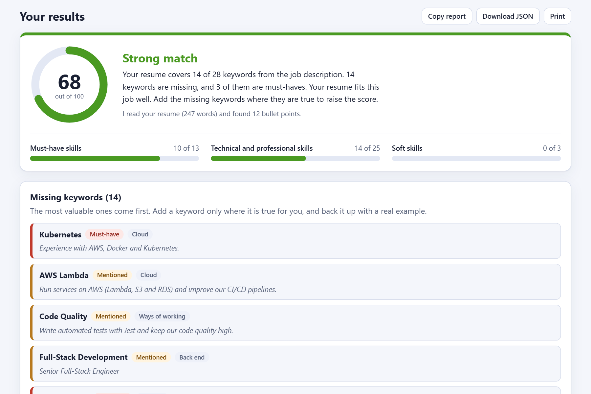
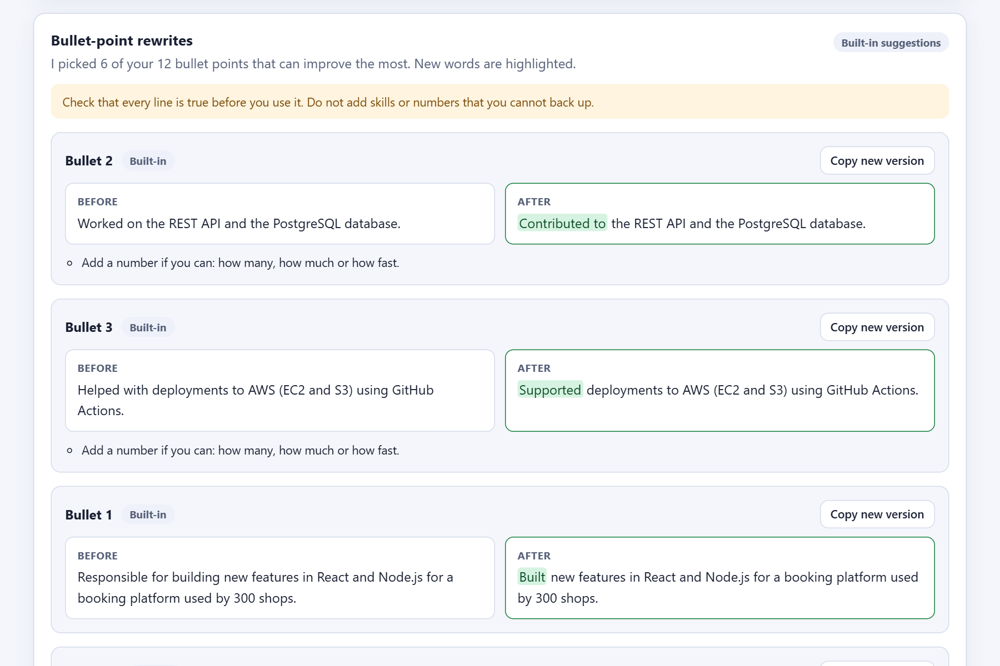

# Resume and Job Match Analyzer

Paste a job description. Upload your resume. In a few seconds you get:

- a **match score** from 0 to 100, with the reasons for it
- the **missing keywords**, with the must-haves first
- **bullet-point rewrites** for the lines in your resume that can improve the most

It runs on your own computer. The score comes from clear rules, not from an AI, so the same input always gives the same score. An AI is optional, and it is only used for the rewrites.





The screenshots use the built-in suggestions, which need no setup. The AI mode writes more tailored rewrites (see [Turn on AI rewrites](#turn-on-ai-rewrites-optional)).

## Try it in one minute

Requirements: Node.js 22.18 or later. Check yours with `node --version`. The app runs the TypeScript files directly, so there is no build step.

1. Run `npm ci`.
2. Run `npm start`.
3. Open http://localhost:3000 and click **Try a sample**.

If `npm start` stops with "This app needs Node.js 22.18.0 or newer", your Node.js is too old. See [Troubleshooting](#troubleshooting).

For your own data, paste the job description. Then upload a resume (`.pdf`, `.docx`, `.txt` or `.md`) or switch to **Paste text**. The page can copy the report as Markdown, download it as JSON, or print only the results.

## What you get

### Match score

The tool finds the skills and keywords that the job description asks for. Then it checks how many of them your resume covers.

- **How much the job cares.** A keyword counts more when the job says it is a must-have. Examples are a heading such as "Requirements", or words such as "must" and "5+ years". It counts less when the job says it is a bonus ("a plus", "nice to have"). Text about the company, the benefits and how to apply is ignored.
- **Weight.** A must-have counts 3, a normal mention counts 2 and a nice-to-have counts 1. A keyword that the job repeats counts up to 2 times as much (at 5 mentions). Soft skills count 0.6 times. Repeated phrases that are not in the skill list count 0.5 times.
- **Implied skills.** A skill counts when your resume names a skill that proves it. For example, React counts for JavaScript.
- **Score.** The weight of the keywords you cover, divided by the weight of all keywords, times 100. The score is never 100 while a keyword is missing.

| Score | Result |
| --- | --- |
| 80 to 100 | Excellent match |
| 65 to 79 | Strong match |
| 50 to 64 | Fair match |
| 35 to 49 | Partial match |
| 0 to 34 | Low match |

The score is a guide. It looks at skills and keywords. It does not judge years of experience, education or how well the resume is written. Recruiters and tracking systems work in their own ways.

The skill list covers technology, business and people skills, with common spellings (for example `k8s` for Kubernetes). To add a skill, add one line in [skills-data.ts](src/analyze/skills-data.ts). The tests fail if two skills share a spelling.

### Bullet-point rewrites

The tool picks up to 6 bullet points that can gain the most. A box in the page lets you choose between the two modes below.

- **Built-in (no setup).** It changes the start of a bullet to a stronger verb. For example, "Worked on" becomes "Contributed to", and "Responsible for building" becomes "Built". It also gives tips, such as "Add a number if you can". It never adds a fact or a keyword. This is useful, but simple.
- **AI (optional).** The AI rewrites a bullet to fit the job. It may use a job keyword only when the bullet already says the same thing. Safety checks run on every answer. They reject a rewrite that adds a number, adds a new tool or skill, makes your role bigger ("helped" becomes "led"), or changes too many words. If the AI fails or is too slow, you get the built-in suggestions.

The safety checks help, but they cannot promise that a rewrite is true. **Read every suggestion. Use it only if it is true.**

## Turn on AI rewrites (optional)

The AI is used only when it is set up **and** the box "Use AI to write the bullet-point rewrites" is ticked. When AI is set up, the page ticks the box for you. Untick it to keep everything on your computer. The server prints at start-up whether AI is on.

**Option 1: GitHub Models.** Use a token that has the `models` permission.

```powershell
# Windows PowerShell
$env:GITHUB_TOKEN = "<your token>"
npm start
```

```bash
# macOS or Linux
GITHUB_TOKEN="<your token>" npm start
```

**Option 2: any OpenAI-compatible server.** For example OpenAI, Azure OpenAI, LM Studio, or Ollama on your own computer.

```powershell
$env:AI_BASE_URL = "http://localhost:11434/v1"
$env:AI_MODEL = "llama3.1"
npm start
```

Set the token in your terminal. Never put it in the code or in a commit. If you prefer a file, copy `.env.example` to `.env.local` (Git ignores it) and start the server with `node --env-file=.env.local src/server.ts`. The app does not read `.env` files by itself.

**What is sent to the AI.** Only three things:

1. the job description (up to 3,500 characters, with emails and links removed)
2. up to 25 keywords from the job
3. up to 6 bullet points from your resume

The rest of your resume is not sent, so your name and contact details stay on your computer. A name or a company inside a bullet is sent as it is written. If the model runs on your own computer (for example Ollama), nothing leaves it.

## Privacy

- **Nothing is saved.** The server keeps no files, no database and no history. The page stores nothing in the browser (no cookies and no local storage).
- **The log has no text.** The server writes one line for each API request: the method, the address, the status and the time.
- **Only your computer can use it.** The server listens on `127.0.0.1` by default.
- **Do not put it on a public server as it is.** It has no login.

## Limits

| Item | Limit |
| --- | --- |
| Resume file | `.pdf`, `.docx`, `.txt` or `.md`, up to 5 MB |
| PDF | Up to 20 pages. It must contain text. Scanned pages are not read (no OCR). Pages with several columns may be read in the wrong order. |
| Password-protected file | Not supported. The page says so. Paste the text instead. |
| Language | English |
| Job description | 50 to 20,000 characters, with at least 3 skills or keywords in it |
| Resume | At least 20 words, and at most 60,000 characters |
| Requests | 30 analyses in 10 minutes for each address |

## Use the API

`POST /api/analyze` accepts a form (`multipart/form-data`) or JSON.

| Field | Needed | Meaning |
| --- | --- | --- |
| `jobDescription` | Yes | The job description as text. |
| `resume` | One of these two | The resume as a file. Forms only. |
| `resumeText` | | The resume as text. |
| `useAi` | No | `true` asks for AI rewrites. The default is `false`. |

```bash
curl -F "resume=@resume.pdf" -F "jobDescription=<job.txt" http://localhost:3000/api/analyze
```

On Windows PowerShell, write `curl.exe` (plain `curl` is a different command there).

```bash
curl -H "Content-Type: application/json" \
     -d '{"jobDescription": "<the job text>", "resumeText": "<the resume text>"}' \
     http://localhost:3000/api/analyze
```

The answer has three parts. Here is a short version:

```jsonc
{
  "match": {
    "score": 68,
    "level": "strong",
    "verdict": "Strong match",
    "summary": "Your resume covers 14 of 28 keywords from the job description. ...",
    "breakdown": [
      { "key": "must-have", "label": "Must-have skills", "matched": 10, "total": 13, "percent": 77 }
    ],
    "matched": [ /* the keywords that your resume covers, in the same shape as "missing" */ ],
    "missing": [
      {
        "key": "skill:kubernetes",
        "label": "Kubernetes",
        "kind": "hard",
        "category": "Cloud",
        "importance": "required",
        "jobCount": 1,
        "resumeCount": 0,
        "weight": 3,
        "snippet": "Experience with AWS, Docker and Kubernetes."
      }
    ]
  },
  "rewrites": {
    "mode": "offline",
    "model": null,
    "notice": null,
    "items": [
      {
        "id": 2,
        "original": "Worked on the REST API and the PostgreSQL database.",
        "rewrite": "Contributed to the REST API and the PostgreSQL database.",
        "source": "offline",
        "keywordsAdded": [],
        "tips": ["Add a number if you can: how many, how much or how fast."],
        "warnings": []
      }
    ]
  },
  "resume": { "source": "text", "fileName": "resume.txt", "characters": 1661, "words": 247, "bullets": 12, "pages": null }
}
```

- `missing` is sorted by value: the most useful keywords come first. `importance` is `required`, `standard` or `preferred`.
- `rewrite` is `null` when there is no safe rewrite. The `tips` still apply.
- `keywordsAdded` lists the job keywords that a rewrite uses and the original did not. Check that each one is true for you.
- Every error has the same shape, for example `{ "error": { "code": "resume_missing", "message": "Add your resume: upload a file or paste its text." } }`. Use `code` in your program and show `message` to people.

Other addresses: `GET /api/health` returns `{"status":"ok"}`. `GET /api/config` tells the page whether AI is on, which model it uses and what the limits are. It never includes a key.

**Protections.**

- The server answers only requests for `localhost` when it listens on a local address.
- A request from another web site is refused (`403 cross_origin`), so a page you visit cannot use your local tool. There are no CORS headers.
- Too many requests get `429 rate_limited` with a `Retry-After` header.
- The page runs under a strict Content Security Policy. It has no inline scripts, no inline styles and no outside files.

## Settings

All settings are optional. They are environment variables.

| Name | Default | Meaning |
| --- | --- | --- |
| `HOST` | `127.0.0.1` | The address to listen on. Another value (for example `0.0.0.0`) lets other computers in and prints a warning, because there is no login. |
| `PORT` | `3000` | The port. |
| `TRUST_PROXY` | `false` | Set to `true` only behind a reverse proxy that you control. The rate limit then uses `X-Forwarded-For`, and the localhost check is skipped. |
| `GITHUB_TOKEN` or `GH_TOKEN` | none | Turns on AI through GitHub Models. |
| `GITHUB_MODELS_MODEL` | `openai/gpt-4o-mini` | The GitHub Models model. |
| `GITHUB_MODELS_ENDPOINT` | `https://models.github.ai/inference` | The GitHub Models address. |
| `AI_BASE_URL` | none | Turns on AI through your own OpenAI-compatible server. It wins over the GitHub token. |
| `AI_MODEL` | none | The model name. Needed with `AI_BASE_URL`. It also replaces the GitHub Models model. |
| `AI_API_KEY` | none | The key for `AI_BASE_URL`, if the server needs one. |
| `AI_JSON_MODE` | `true` | Set to `false` if your server does not support `response_format=json_object`. |
| `AI_TIMEOUT_MS` | `30000` | How long to wait for the AI (1000 to 120000). Then the built-in suggestions are used. |

If a number or an address is not valid, the server prints a warning when it starts. It then uses the default, or turns AI off. The limits in the [Limits](#limits) table are fixed in [config.ts](src/config.ts) and [app.ts](src/app.ts).

## Project layout

```text
public/       The web page: plain HTML, CSS and JavaScript, with no build step
  samples/    The job description and resume for "Try a sample"
src/
  analyze/    The match engine: skill list, job reading, scoring, bullets, built-in rewrites
  ai/         The optional AI step: prompt, client, reply reader and safety checks
  extract/    Reads PDF, Word (.docx) and text files
  http/       Request reading, security checks and the rate limit
  app.ts      The Express app and its routes
  server.ts   Starts the server
  config.ts   Settings and limits
  service.ts  The whole job, from the input to the answer
  rewrites.ts Chooses the AI or the built-in rewrites
test/         The tests. They use a fake AI server, so they need no token and no internet.
scripts/      A check that stops start, dev and test with a clear message when Node.js is too old
docs/         The screenshots for this file
```

The server uses Express, [multer](https://github.com/expressjs/multer) for uploads, [unpdf](https://github.com/unjs/unpdf) for PDF text and [zod](https://zod.dev) to check input. Word files are read by a small reader in `src/extract`, which limits how much a file may unpack to.

## Develop

| Command | What it does |
| --- | --- |
| `npm start` | Runs the server. |
| `npm run dev` | Runs the server and restarts it when a file changes. |
| `npm test` | Runs all the tests. |
| `npm run typecheck` | Checks the types of the server, the tests and the browser code. |
| `npm run build` | Compiles the server to `dist/`. |
| `npm run start:dist` | Runs the compiled server from `dist/`. |

`npm start`, `npm run dev`, `npm test` and `npm run start:dist` first run [check-node.mjs](scripts/check-node.mjs). It stops with a clear message when your Node.js is older than the `engines` value in `package.json`.

## Troubleshooting

### "This app needs Node.js 22.18.0 or newer", or `Unknown file extension ".ts"`

Your Node.js is too old. The app runs TypeScript files directly, and that needs Node.js 22.18 or newer. `npm ci` also warns about it with `EBADENGINE`.

1. Run `node --version`. It must show `v22.18.0` or higher.
2. If it does not, install Node.js 22 or newer from https://nodejs.org/, or switch with your version tool (for example `nvm use 22`).
3. Node.js 22 is installed, but this terminal still uses an older one? Use the newer one for this terminal window only. Put its folder first in the `PATH`:

```powershell
# Windows PowerShell. Use the folder that has node.exe for Node.js 22.
$env:Path = "C:\path\to\node-22;$env:Path"
node --version
npm start
```

```bash
# macOS or Linux
export PATH="/path/to/node-22/bin:$PATH"
node --version
npm start
```

The change lasts only for that terminal window.

### "Port 3000 is already in use"

Another program, or a second copy of this app, uses the port. Close it, or pick another port:

```powershell
# Windows PowerShell
$env:PORT = "3001"
npm start
```

```bash
# macOS or Linux
PORT=3001 npm start
```

## Ideas for later

- Read scanned PDFs with OCR.
- Support more languages.
- Compare one resume with several jobs.
- Export the improved resume as a Word file.

## License

There is no license file yet. Add one before you share the code publicly.
